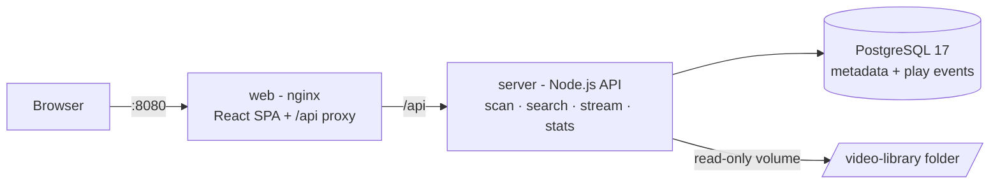

# Video Library

A modern, self-hosted web video library. Videos are organized by the physical folder /
subfolder structure inside the `video-library` folder — folders become searchable
categories automatically. Includes a full administration site with metadata management
and insight reports. Everything runs in Docker with a single command.

## Features

**Library site** (`/`)

- Responsive video grid with **hover preview** (videos play on mouse-over)
- **Vertical category tree** sidebar — a collapsible, dynamic tree of every
  folder/subfolder; click a category to see all its videos
- **Tag cloud** at the end of the left sidebar — every tag used in the library,
  sized by usage; click a tag to see all videos associated with it
- Full-text search across title, description, tags and file name
- Dynamic **cascading category filters** generated from the folder structure
- Sorting by newest, title, most played, longest, largest
- **Like** (♥) and **favorite** (★) any video from the card or the player
- Full-screen player with complete metadata panel
- One-click **download** of any video
- Play and download counters

**Favorites** (`/favorites`)

- Personal section with every video you marked as favorite
- Search and sort (recently favorited, title, most played, longest…)
- Remove a single favorite (click ★ again) or **clear all favorites** at once

**Administration site** (`/admin`)

- Edit title, description and tags of every video (searchable in the library instantly)
- **`#` tag autocomplete** — while editing tags, type `#` followed by a word to
  get suggestions from existing tags, minimizing typos when tagging videos
- One-click **library re-scan** to pick up new/removed files
- Paginated, searchable management table

**Insights** (`/admin/insights`)

- Summary cards: total videos, categories, size, duration, plays, downloads
- Most played chart, plays-over-time chart (last 30 days)
- Category tree view with counts per folder
- Recently added videos

## Technology stack

| Layer | Technology |
| --- | --- |
| Frontend | React 18 + TypeScript (Vite), Recharts |
| Backend | Node.js + Express + TypeScript |
| Database | PostgreSQL 17 |
| Streaming | HTTP range requests (instant seeking) |
| Metadata | ffprobe (duration/resolution extraction) |
| Hosting | Docker Compose (nginx serves the SPA and proxies the API) |

## Prerequisites (Windows)

1. [Docker Desktop for Windows](https://www.docker.com/products/docker-desktop/) — running
2. PowerShell 5.1+ (built into Windows) or PowerShell 7

Nothing else is required — Node.js, Postgres and ffmpeg all live inside the containers.

## Quick start

```powershell
# 1. Drop your video files into the video-library folder (any folder depth)
#    video-library\long-videos\Category A\my-video.mp4

# 2. Start everything (builds images on first run)
.\scripts\start.ps1
```

Then open:

| URL | Purpose |
| --- | --- |
| <http://localhost:8080> | Library site |
| <http://localhost:8080/favorites> | My favorites |
| <http://localhost:8080/admin> | Administration |
| <http://localhost:8080/admin/insights> | Insight reports |
| <http://localhost:4000/api/health> | API health check |

The library is scanned automatically at startup. Supported formats:
`.mp4`, `.webm`, `.mov`, `.mkv`, `.avi`, `.m4v`, `.ogv`
(browser playback works best with `.mp4` / `.webm`; other formats can still be downloaded).

## Windows scripts

All scripts are in the `scripts` folder:

| Script | What it does |
| --- | --- |
| `start.ps1` | Build (if needed) and start all containers, prints the URLs |
| `stop.ps1` | Stop containers — metadata and statistics are preserved |
| `rebuild.ps1` | Rebuild images after code changes and restart |
| `rescan.ps1` | Re-scan the `video-library` folder for new/removed files |
| `logs.ps1 [service]` | Follow logs (`server`, `web`, `db`, or all) |
| `reset.ps1` | Delete all metadata/statistics (asks for confirmation; video files are never touched) |

> If script execution is blocked, run once:
> `Set-ExecutionPolicy -Scope CurrentUser RemoteSigned`

## How categories work

Folders inside `video-library` become categories. Example:

```text
video-library/
├── long-videos/
│   ├── Category A/
│   │   ├── Category A/   ← nested subcategory
│   │   └── Category B/
│   └── Category B/
└── short-videos/
    └── ...
```

A file at `video-library\long-videos\Category A\Category B\clip.mp4` gets:

- Category path: `long-videos / Category A / Category B` (drives the cascading filters)
- Automatic tags: `long-videos`, `Category A`, `Category B`
- Title: `clip` (cleaned from the file name; editable in Administration)

Renaming, adding or deleting files/folders is picked up on the next scan
(`scripts\rescan.ps1` or the **Rescan library** button in Administration).

## Configuration

Copy `.env.example` to `.env` to change defaults:

```ini
POSTGRES_USER=videolib
POSTGRES_PASSWORD=videolib   # change this for anything beyond local use
POSTGRES_DB=videolib
WEB_PORT=8080                # library site port
API_PORT=4000                # direct API port
```

## Architecture



- The `video-library` folder is mounted **read-only** into the API container —
  the application can never modify or delete your video files.
- Database data lives in the `pgdata` Docker volume and survives restarts.
- Video streaming uses HTTP range requests, so seeking is instant and previews
  only download the bytes they need.

## API overview

| Method | Endpoint | Description |
| --- | --- | --- |
| GET | `/api/videos` | Search/filter/paginate (`search`, `category`, `tag`, `sort`, `page`, `pageSize`, `favorites=true`, `liked=true`) |
| GET | `/api/videos/:id` | Video details |
| GET | `/api/videos/:id/stream` | Range-enabled streaming |
| GET | `/api/videos/:id/download` | Download the original file |
| POST | `/api/videos/:id/play` | Register a playback |
| POST | `/api/videos/:id/like` | Toggle like on a video |
| POST | `/api/videos/:id/favorite` | Toggle favorite on a video |
| POST | `/api/videos/favorites/clear` | Remove all favorites |
| GET | `/api/categories` | Category tree with counts |
| GET | `/api/tags` | All tags with usage counts (for tag cloud/autocomplete) |
| POST | `/api/admin/scan` | Re-scan the library folder |
| PATCH | `/api/admin/videos/:id` | Update title/description/tags |
| GET | `/api/stats/summary` | Library totals |
| GET | `/api/stats/top-played` | Most played videos |
| GET | `/api/stats/recent` | Recently added |
| GET | `/api/stats/plays-over-time` | Daily plays for the last N days |

## Local development (optional, without Docker)

Requires Node.js 22+ and a local Postgres 17 (or run only the db container:
`docker compose up -d db`).

```powershell
# Backend (http://localhost:4000)
cd server
npm install
npm run dev

# Frontend (http://localhost:5173, proxies /api to :4000)
cd client
npm install
npm run dev
```

## Troubleshooting

| Problem | Fix |
| --- | --- |
| `start.ps1` says Docker is not running | Start Docker Desktop, wait for it to be ready |
| Videos don't appear | Check the file extension is supported, then run `scripts\rescan.ps1` |
| Port 8080/4000 already in use | Set `WEB_PORT` / `API_PORT` in `.env`, then `scripts\rebuild.ps1` |
| A video won't play in the browser | `.mkv`/`.avi` are often unsupported by browsers — use Download, or convert to MP4 (H.264) |
| Want a clean slate | `scripts\reset.ps1` (video files are never touched) |
| See what's happening | `scripts\logs.ps1 server` |
